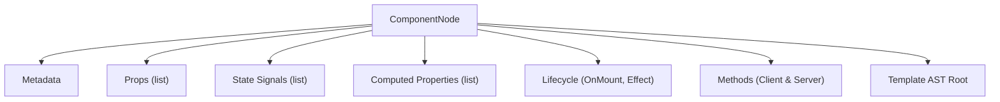

# spec/ir.md — Intermediate Representation (IR) Kylat v0

Status: **Draf Normatif**.
Disahkan: 25 Oktober 2026.
Bergantung pada: [`spec/php-subset.md`](file:///c:/Users/haidaryuum/source/kylat/spec/php-subset.md), [`spec/template.md`](file:///c:/Users/haidaryuum/source/kylat/spec/template.md), [`spec/compiler-rules.md`](file:///c:/Users/haidaryuum/source/kylat/spec/compiler-rules.md).

---

## 1. Prinsip Desain IR

1. **Bebas dari Sintaks PHP & Blade**: IR adalah pohon sintaksis teranotasi (*typed semantic tree*) murni. Setelah tahap parser dan semantic analyzer selesai, tahap codegen menghasilkan JavaScript tanpa perlu mengetahui konstruksi sintaksis PHP asli.
2. **Reaktivitas Berbasis Fine-Grained Signals**: Node IR merepresentasikan deklarasi sinyal state, getter terkomputasi, dan binding langsung ke operasi mutasi DOM riil, bukan virtual DOM.
3. **Tipe Data Lengkap & Eksplisit**: Setiap node ekspresi dalam IR memiliki anotasi tipe data v0 (`int`, `float`, `string`, `bool`, `null`, `list<T>`, `array<string, T>`).
4. **Deterministik & Dapat Diserialisasi**: IR dapat diserialisasi ke dalam bentuk JSON AST untuk keperluan *tooling*, visualisasi graf dependensi sinyal, serta pengujian *golden test*.

---

## 2. Struktur Hierarki IR

Satu berkas komponen Kylat diterjemahkan menjadi satu root node `ComponentNode`:



---

## 3. Spesifikasi Node IR

### 3.1 `ComponentNode`
Node akar yang merepresentasikan satu komponen Kylat utuh:

```typescript
export interface ComponentNode {
  kind: 'Component';
  name: string;             // Nama kelas komponen (misal 'ProductCard')
  tag: string;              // Nama tag kebab-case (misal 'x-product-card')
  filePath: string;         // Lokasi berkas sumber
  props: PropNode[];
  state: StateNode[];
  computed: ComputedNode[];
  effects: EffectNode[];
  onMount?: OnMountNode;
  clientMethods: MethodNode[];
  serverActions: ServerActionRefNode[];
  children: ChildComponentDeclNode[];
  template: TemplateRootNode;
}
```

### 3.2 Deklarasi Anggota Komponen

```typescript
export interface PropNode {
  kind: 'Prop';
  name: string;
  type: KylatType;
  defaultValue?: ExpressionNode;
  loc: SourceLocation;
}

export interface StateNode {
  kind: 'State';
  name: string;             // Nama variabel state
  type: KylatType;
  initialValue: ExpressionNode;
  loc: SourceLocation;
}

export interface ComputedNode {
  kind: 'Computed';
  name: string;
  returnType: KylatType;
  dependencies: string[];   // Nama state/prop yang dibaca
  body: StatementNode[];
  loc: SourceLocation;
}

export interface EffectNode {
  kind: 'Effect';
  name: string;
  dependencies: string[];   // Signal yang memicu efek
  body: StatementNode[];
  loc: SourceLocation;
}

export interface OnMountNode {
  kind: 'OnMount';
  body: StatementNode[];
  loc: SourceLocation;
}

export interface MethodNode {
  kind: 'Method';
  name: string;
  params: ParamNode[];
  returnType: KylatType;
  body: StatementNode[];
  loc: SourceLocation;
}

export interface ServerActionRefNode {
  kind: 'ServerActionRef';
  contractClass: string;    // Misal 'CartActions'
  loc: SourceLocation;
}

export interface ChildComponentDeclNode {
  kind: 'ChildComponentDecl';
  className: string;        // Nama kelas komponen anak, misal 'Counter'
  tag: string;              // Tag kebab-case, misal 'x-counter'
  loc: SourceLocation;
}
```

---

## 4. Template AST

Templat komponen dikompilasi menjadi pohon node templat reaktif:

```typescript
export type TemplateNode =
  | ElementNode
  | TextNode
  | InterpolationNode
  | IfNode
  | ForEachNode
  | ComponentInstanceNode;

export interface TemplateRootNode {
  kind: 'TemplateRoot';
  children: TemplateNode[];
}

export interface ElementNode {
  kind: 'Element';
  tag: string;
  attributes: AttributeNode[];
  directives: DirectiveNode[];
  children: TemplateNode[];
  loc: SourceLocation;
}

export interface TextNode {
  kind: 'Text';
  value: string;
  loc: SourceLocation;
}

export interface InterpolationNode {
  kind: 'Interpolation';
  expression: ExpressionNode;
  escaped: true;             // Selalu true di v0 (KIL-152)
  loc: SourceLocation;
}

export interface IfNode {
  kind: 'If';
  condition: ExpressionNode;
  consequent: TemplateNode[];
  alternate?: IfNode | TemplateNode[]; // elseif atau else
  loc: SourceLocation;
}

export interface ForEachNode {
  kind: 'ForEach';
  source: ExpressionNode;   // Ekspresi list sumber
  itemVar: string;          // Nama variabel item ($item)
  keyExpr: ExpressionNode;  // Ekspresi wajib atribut key (KIL-155)
  body: TemplateNode[];
  loc: SourceLocation;
}

export interface ComponentInstanceNode {
  kind: 'ComponentInstance';
  targetClass: string;      // Nama kelas komponen anak
  tag: string;              // 'x-nama'
  props: ComponentPropBindNode[];
  keyExpr?: ExpressionNode; // Wajib jika berada di dalam ForEachNode
  loc: SourceLocation;
}
```

---

## 5. Atribut dan Direktif

Sesuai aturan tiga kelas nilai atribut di [`spec/template.md` §4](file:///c:/Users/haidaryuum/source/kylat/spec/template.md):

```typescript
export type AttributeNode =
  | StaticAttributeNode
  | DynamicAttributeNode;

export interface StaticAttributeNode {
  kind: 'StaticAttribute';
  name: string;             // misal 'class', 'id', 'aria-label'
  value: string;
}

export interface DynamicAttributeNode {
  kind: 'DynamicAttribute';
  name: string;             // misal 'href' dari ':href'
  expression: ExpressionNode;
}

export type DirectiveNode =
  | BindDirectiveNode
  | OnDirectiveNode
  | ErrorDirectiveNode;

export interface BindDirectiveNode {
  kind: 'BindDirective';
  targetState: string;      // Wajib merujuk ke nama StateNode lokal
  loc: SourceLocation;
}

export interface OnDirectiveNode {
  kind: 'OnDirective';
  event: 'click' | 'input' | 'change' | 'submit' | 'keydown';
  handlerMethod: string;    // Nama method Client atau Server
  args: ExpressionNode[];
  loc: SourceLocation;
}

export interface ErrorDirectiveNode {
  kind: 'ErrorDirective';
  fieldPath: string;        // Jalur state bertitik, misal 'email' atau 'items.0.qty'
  loc: SourceLocation;
}
```

---

## 6. Sistem Tipe Data IR

```typescript
export type KylatType =
  | { kind: 'primitive'; name: 'int' | 'float' | 'string' | 'bool' | 'null' }
  | { kind: 'list'; itemType: KylatType }
  | { kind: 'map'; keyType: 'string'; valueType: KylatType }
  | { kind: 'enum'; enumName: string; cases: string[] }
  | { kind: 'nullable'; innerType: KylatType };
```

---

## 7. Pipeline Transformasi: PHP → IR → Codegen

```
+--------------------------+
|  Berkas Komponen (.php)  |
+--------------------------+
             |
             v  [Step 1: Parser (Spike S1)]
+--------------------------+
|  Raw AST (PHP + Markup)  |
+--------------------------+
             |
             v  [Step 2: Semantic Analysis & Diagnostic]
             |  - Penegakan KIL-101 s/d KIL-311
             |  - Resolusi tipe data
             |  - Inferensi sinyal & dependensi
+--------------------------+
|  Kylat Component IR      |
+--------------------------+
             |
             v  [Step 3: Direct DOM Codegen]
+------------------------------------------+
|  JavaScript Fine-Grained Signals Bundle  |
|  (Operasi DOM langsung tanpa Virtual DOM)|
+------------------------------------------+
```

---

## 8. Pemetaan ke Codegen JavaScript (Target Runtime)

1. **State**: Setiap `StateNode` dikompilasi menjadi instansiasi signal:
   ```javascript
   const [count, setCount] = createSignal(initialValue);
   ```
2. **Computed**: Setiap `ComputedNode` dikompilasi menjadi memo/computed signal:
   ```javascript
   const total = createMemo(() => count() * 10);
   ```
3. **Template Cloning**: Elemen DOM statis di-render menggunakan template element cloning (`template.content.cloneNode(true)`) untuk performa maksimal.
4. **Dynamic Binding**: Sinyal langsung dihubungkan ke `node.textContent` atau atribut elemen melalui reactive effect mikro tanpa virtual DOM overhead.
